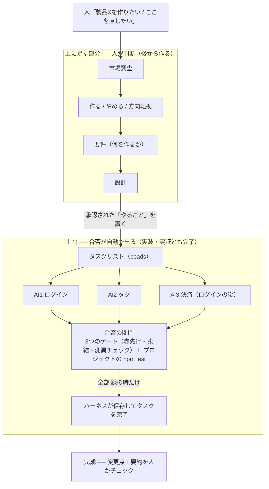

# DESIGN — 複数の製品を同時に AI に任せて開発する仕組みの設計

この文書は、この仕組みの「何を作りたいか」と「どう作るか」をまとめたもの（設計の SoT）

**位置づけ**：設計 → 部品ごとの実証 → 1本に統合 → 本物のリポジトリで実行、まで済んだ状態を記述

読む順番は上から
「作りたい物」→「**どう動くか（§2 の通しフロー＝ここが本体）**」→「工程と関門」→「守ること」→「作り方」→「実際にできるか」→「**決めたこと／やらないこと**」
細かい調べ物（他社ツール・公式情報）は末尾の付録に集約

**この文書は「確定版」だけを書く**
どう辿り着いたか（過程）は書かない——過程は決定が変わるたびに実態とずれ、**古い決定として読めてしまう**から
過程が要るなら git 履歴と [proof/README](proof/)（実証の記録）を参照
**ただし「なぜそう決めたか（理由）」と「実測で分かった制約」は過程ではないので必ず残す**（消すと同じ議論と同じ失敗を繰り返す）

---

## 1. 作りたいもの（一言で）

**1台のパソコンで、複数の製品を、AIに指示するだけで同時に開発させる**
人がやるのは「何を・どうなったら完成かを指示する」ことと「出来上がりを確認する」こと
コードを書く・テストする・直す・保存（コミット）は AI が自分で繰り返す

### 完成形イメージ（何を目指すか）

**前半（何を作るか）は人が判断・承認、後半（コードを書く・テスト）は AI が同時並行で自動で進める**



各AIは**別々の作業コピー**で動く（互いのファイルを触らない）、既存の製品なら承認を挟まず会話で直接タスクを登録

※ 関門の中身（3つのゲート）と1タスクの流れは **[§2 の通しフロー](#2-どう動くか)**

二段構え:
- **土台＝図の「土台」の枠（コードを書く＋テスト）**：ゲートが合否を判定するので、AIが自分で進められる
  **これ単体でも役立つ**（会社の既存の製品にそのまま使える、要件は人が用意済みなので指示を出すだけ）＝ **実装・実証とも完了**（§6）
- **上に足す部分＝図の「上に足す部分」の枠（調査→決定→要件→設計→…→自己改善）**：人が判断するので一旦止まる
  新しい製品をゼロから作る全体像、**後から足す**

→ 土台は独立した部品なので、いつでも「一部だけ」利用可能（§3）

## 2. どう動くか

以降、テストが全部通る状態を**緑**、1つでも落ちる状態を**赤**と呼ぶ

まず言葉の意味（以降の説明はすべてこの定義に従う）:
- **指示** … 人がAIに渡す、大まかな依頼、例「製品Xにログイン機能をつけて」
- **タスクリスト** … やることを登録する共有の台帳、「やること」を1件ずつ登録（中身は後述の beads というツール）
- **ワーカー（AIの作業1本）** … タスクリストから1件取って、それを仕上げる独立したAIの作業
- **完成** … その1件が「終わった」と**人が見なくても確かめられた**状態（例：その機能をチェックするテストが全部通る）

### 通しフロー（1タスクの流れ）— ここが本体

**入口：人が会話で言う**「ログイン作って、その後 決済、あとタグ」
→ AIがタスクリストに1件ずつ登録する（`bd create`、**人はファイルを手で書かない**）、依存も設定（決済はログインの後）

**そこから先は、ハーネス（親）が各ワーカーについてこれを実行する:**

0. **ワーカーを起動** ── 別々の作業コピー（git worktree）で隔離／本数・予算・緊急停止の範囲内（§4-8）

1. **タスクリストから1件 claim** ── ワーカーごとに別の名前（`BEADS_ACTOR`）が必須（§4-5）
   - 取れる仕事が無い時（依存待ち／全部 claim 済み）は、すぐ終わらず少し待って再挑戦（依存が解けて ready になるかもしれない）
   - 終了条件: タスクリストに「終わっていない仕事」が1つも無くなったら、ワーカーが自分で終了
   - 待機にも上限（永久に待たない＝終了保証）

2. **ワーカーが「テストだけ」書く**（実装は書かせない）

3. **ゲート1｜赤先行** ── ハーネスが「実装が無い状態」でテストを実行
   - 緑になった → REJECT（実装が無いのに通る＝何も検証していない）

4. **ゲート2｜凍結** ── テストのハッシュを記録

5. **ワーカーが実装する**（「書く→テスト→直す」を自分で繰り返す＝内側の繰り返し）
   - 緑になったら「終わった」と申告（close も commit もハーネスの仕事・ワーカーが自分で実行してもハーネスが取り消し）

6. **凍結の検証** ── `tests/` の**どのファイル**でも1文字変わっていたら REJECT（テストを弱めて通す不正）
   - 今回 書いたテストだけでなく、既存のテストも対象（別ファイルを弱める抜け道を防ぐ）

7. **チェック一式（＝プロジェクトの `npm test`）をハーネスが自分で走らせる**
   - ハーネスが呼ぶのは `npm test` だけ、型やビルドも見たいなら test スクリプトに組み込み
   - 赤 → ワーカーに差し戻し（下の再試行の階層で打ち切り）

8. **ゲート3｜変異チェック** ── 実装をわざと壊して、テストが気づくか
   - 生き残った変異が1個でもある → REJECT（テストが実装を十分に検証していない）
   - **REJECT の前に自己チェック** ── その生き残りを1個ずつ 手で適用し直し、素の `npm test` を実行
     - 赤 → テストは変異を検出できている＝ツールが誤動作している → ゲートを使わず人に差し戻し
     - 緑 → 本物の生き残り → REJECT を確定
   - 生き残りを次のワーカーに渡して **2 からやり直し**（変異チェックが出した事実を伝達）
   - 再試行は2階層 ── 同じ会話で3回（`MAX_ATTEMPTS`）→ それでも不合格なら会話の記憶を捨てて新しい会話でやり直す（`MAX_ROUNDS`・既定2）→ 人に差し戻し（2階層にした理由は §4「通らなかった時」）
   - ループは止めない（他のワーカーは次へ）

9. **ここで初めて保存** ── ハーネスが `git commit` ＋ `bd close`
   - ワーカーが自分でコミットしていたら、ハーネスが呼び出しの直後に取り消し済み（commit を許すとゲートを1つも通らずに保存できてしまう・§7-2①）
   - 見張り中モードは commit 前に人が変更点を確認／放置モードは自動 ── 見張り中モードは未実装

10. **終わったブランチを1本ずつ main に統合＋毎回 全テストを再実行**
    - 緑なら採用／赤なら巻き戻して main を緑のまま保つ

**10 の後は 1 に戻る**（次の1件へ）── これが外側の繰り返し、0 は最初の1回だけ

**この流れの読み方（3つ）:**
- **ワーカーは作業するだけ、合否を判定するのはハーネスだけ**
  実際にチェックを走らせて緑を見た者（ハーネス）だけが完了・保存できる、**ワーカーに commit / close の役割を渡さない**＝AIの「できました」宣言では1行も保存されない<br>※ **権限で止まっているのではない** ── ワーカーは作業コピーの中で `git commit` も `bd close` も実行できてしまう、ハーネスが呼び出しの前後で検出して**取り消す／開け直す**ことで成立（proof の落とし穴25・29）
- **テストの良し悪しも、人ではなくゲートが判定する**（ゲート1・2・3＝§4）、**人の承認をループの中に入れない**（理由は §4）
- **並列が効くのは「独立したタスクが複数ある」時だけ**
  依存が直列に連なっていると、**ワーカーを増やしても1本しか動かない**（後続は待機するだけ）＝ **人が"独立した仕事"を割り当てることが、並列の前提**

**本体は「タスクリスト」ではなく「繰り返し（ループ）」の方**
タスクリスト（beads）は「何を・どの順番で・誰が取ったか」を覚えておくだけの台帳
価値の中心は、各ワーカーが繰り返す**「取る→書く→テスト→直す→緑→完了→次」の流れ**と、**「実際にテストを走らせて緑でしか完了にしない」厳しい関門**
タスクリストはそれを支える1部品にすぎない

**割り当て方は「両方」できる（信頼度で使い分け）:**
- **見張り中（最初）＝人が指名**：人が「このAIにログイン」と特定のワーカーに直接割り当てる、タスクリストは裏で「順番・取り合い防止・記憶」を担当
- **放置（信頼が蓄積したら）＝AIが取りに行く**：人はタスクリストに登録するだけ、各ワーカーが空いている1件を自分で取って進める
- どちらもタスクリストが土台、だから段階的に移行できる（**信頼ランプ**＝人がAIを信じるにつれ 見張り中→半自動→放置 と自律度を上げること＝§4「完成の定義」）
- 見張り中は beads の「取りに行く（ready・claim のプール）」機能はほとんど使わず、**裏側（依存順・claim排他・記憶・重複検知）として働く、プールが本来の機能を発揮するのは放置モード** 同じタスクリストの上で使う機能が段階的に増加

**タスクリストは「1つ」・コードは「別々」（並列の前提）:**
- **タスクリストは共有**（`.beads/` はメインリポジトリに1つ、作業コピーをまたいで同じタスクリストを見る）、だから **claim 排他・依存の順・重複検知が、別々に動くワーカーの間で有効**
- **コードは作業コピーで隔離**（git の `worktree` ＝同じプロジェクトの作業コピーを複数持つ機能）、互いのファイルを触らない
- **複数製品＝この仕組み一式をコピーするだけ**（タスクリストは製品ごとに1つ・リポジトリごとに `bd init`）、**製品をまたいで全体を管理する仕組みは作らない**（＝今の前提「1台のPC・製品が数個」では不要、前提が変わったら見直す＝§7-2③）

**人が手でやっていた繰り返しを、ハーネスに肩代わりさせる（ここが要点）:**
今あなたがAIを使うとき、手でこうしている → それをハーネスに渡す:

| 今 人が手でやっている | 肩代わり |
|---|---|
| 何を作るか指示する | **人のまま**（会話で、AIがコマンド化してタスクリストに登録する） |
| やることの順番・取り合いの管理 | **タスクリスト（beads）**（依存の順・早い者勝ちの確保） |
| 何を「完成」とするか（合否テスト） | **AIがテストを先に書く → その質を3つのゲートが判定**（赤先行＋凍結＋変異チェック・§4）、人の承認は重要な所だけ |
| 出力を読んで「終わった？正しい？」と判断 | **`npm test` が判定（実際にテストを走らせて緑か）** ← ここが本体 |
| ダメなら「続けて」と言い直す | **ハーネスが不合格の中身を渡して呼び直す**（`MAX_ATTEMPTS`・`MAX_ROUNDS`） |
| 完成・保存 | ハーネスがテスト通過で自動保存、人は後でチェック |
| 互いに邪魔しないように | 別々の作業コピー（git worktree） |

→ 人は **「何をやるか決める人」のまま**、**「1回1回言い直す係」の役割だけがなくなる**
（Claude Code 開発者 Boris Cherny の言う「自分の仕事は"繰り返しの仕組み"を書くこと」にあたる、役割が「言い直す人」から「言い直す仕組みを作る人」へ変化）
なお この §2 は、下の工程でいう「コードを書く工程」の中身、全工程の中での位置は §3

## 3. 工程の流れと「工程ごとの関門」

新しい製品をゼロから作る場合は、工程が連なる
**各工程には「次に進んでいい？」を判定する関門があり、その種類が工程ごとに違う**

- **自動で合否が出る関門**：テストが通った/通らない のように**コマンドが exit code で答えを返せる** → **人がいなくても通れる（AIが自分で進める）**
- **人しか判定できない関門**：良し悪しを人しか決められない → **止まって人を待つ（AIだけでは進めない）**

| 工程 | 関門 | AIだけで進める？ |
|---|---|---|
| 市場調査 | 人（良い調査か？） | 不可 ── 止まって人が見る |
| **作る/やめる/方向転換の決定** | **人・最重要**（手がかりが無い製品判断） | 不可 ── **人が必須**（AIに「この製品をやめる」を自動で決めさせない） |
| 要件（何を作るか） | 人（この要件でいいか？） | 不可 ── 承認待ち |
| 設計 | 人（この設計でいいか？） | 不可 ── 承認待ち |
| **コードを書く** | **`npm test`（通った？）** | 可 ── 自分で進める |
| **テスト** | **`npm test`（全部通った？）** | 可 ── 自分で進める |
| （自己改善＝AIが自分のやり方を直す） | 手がかり少・最高リスク（悪く直すと全部おかしくなる） | 条件つき ── 専用の関門＋人チェック・後回し |

**鉄則：「正しく作る（コード・テスト）」はゲートで自動、「正しい物を・作るべきか（調査・決定・設計）」は人の関門、混ぜない**
ゲートが合否を出せるのはコード・テストの工程だけ
手前の工程には合否を出すコマンドが存在しない

**並列実行の仕組みは全工程で共通・違うのは関門だけ:** タスクリスト（beads）＋並列ワーカー＋「繰り返し」という仕組みは、実装だけでなく上の工程（市場調査・アイデア探し・要件・設計）にもそのまま利用可能
調査やアイデア出しも「タスクリストに登録して並列で実行する」ことはできる
**違うのは関門（合否を誰が出すか）だけ**——実装/テストは `npm test`（緑で自動）、調査・アイデア・要件・設計は人（良し悪しは人が判断して止まる）
だからAIは調査を「生産」はできるが、「採用（作る/やめる）」は人が決定（§6）

**自己改善は2段に分ける（記憶＝安全な第一歩）:**
上の表の「自己改善」は最高リスクだが、中身は2段に分かれる:
- **レベル1＝記憶ヒント（やる・安全）**：ワーカーが"やって分かった学び"を覚え、次のタスクで再利用、ループを繰り返すたびに学びが蓄積
- **レベル2＝AIが自分のやり方（ルール・ハーネス）を書き換え（後回し・最高リスク）**：悪く改造すると全部おかしくなる（表の「最高リスク」はレベル2）

→ 記憶（レベル1）の**具体設計**（`bd remember`／`prime`／`forget`／`prune` の使い方）と「**記憶 vs CLAUDE.md**（混同しない）」の表は、**付録2「記憶（`bd remember`）の設計」**に記載（beads のコマンドなので beads の付録に置いた）

**一部だけ使える（重要な設計の考え方）:**
各工程を**独立した部品（関門つき）**として作れば、**状況に応じて一部だけ利用可能**

- **全工程**（調査→…→テスト）＝ 新しい製品をゼロから、人の関門が多い
- **コード＋テストだけ**＝ 既存の製品（要件は人が用意済み）、会社の製品にそのまま使える ← **これが土台・今すぐ役立つ・実証済み**

## 4. 絶対に守ること

「必ずこうであるべき」という条件、作るものはこれを満たす

**まず「AIが進められる指示」の線引き:**
- **対象**：AIが自分で進められるのは「**コマンドで合否が出る作業**」（＝**ゲートを置ける工程**＝コード・テスト）だけ
  テストで確かめられない指示（調査・設計・方向転換の判断）は人の関門側で、人が完成を判断
- **指示の大きさ**：指示は「**AI1本で終わる大きさ**」にする
  大きすぎると終わらず、途中で止まって失敗になる → 事前に人が小さく分割

**守ること（コード・テストの工程について）:**
1. **「完成」はコマンドが判定する（既存ツールを走らせて）** そのプロジェクトが決めた「チェック一式」が全部パスすること
   - **必須**：**3つのゲートを通ったテスト**が `npm test` で通ること ── **ハーネスが走らせるのは `npm test` だけ**
   - ビルド・型チェック・lint・セキュリティ検査を合否に含めたいなら、**プロジェクトが `npm test` の中に組み込む**（例 `"test": "tsc --noEmit && vitest run"`）
   - 判定は既存ツール（OSS）の出力＝客観、AIは「ツールを通す」役（AIの意見で決めない）
   - **完了（`bd close`）と保存（commit）は、ワーカーではなくハーネス（親）が、自分でチェック一式を走らせて緑を確認した後だけ実行**（ワーカーに close/commit をさせない＝AIの「終わった」宣言では完了にしない、**権限では止まらない**ので取り消す仕組みは §2「この流れの読み方」と §7-2①）、手順は §2 の通しフロー
   - **ベース（main）は常に緑に保つ**、**未着手タスクの受け入れテストを main に先置きしてはいけない**——並列だと**各ワーカーの作業コピーに「他タスクの赤いテスト」が入り、全員のゲートが赤のまま永久に通らなくなる**（実機で発生）
     **各タスクの受け入れテストは、そのタスクのワーカーが自分の作業コピーで書く**（＝要件2）、1ワーカーなら起きないが、**並列にした瞬間に破綻**
2. **完成の条件は「テスト」で表す、テストは実装より先に書き、その質は3つのゲートが判定する**（3つの中身は下の節／手順は §2 の通しフロー）
   **人の承認は二次の層**（下の「人とチェック役AIは二次の層」）
3. **完成の証拠＝その「3つのゲートを通ったテスト」が通ること**（2と一対）今まであるテストが通る（＝壊していない）だけでは未完成
4. **AIの「できました」を鵜呑みにしない** 完成の条件を満たしていなければ未完成
5. **AIの作業は共有のタスクリストで調整する** 複数のワーカーが同じタスクリストを見て、早い者勝ちで1件を確保（claim） → 同じ仕事を2人が同時にやらない
   - **前提：ワーカーごとに別の名前を与えること**（beads に「誰として操作するか」を伝える値・`BEADS_ACTOR=w1 / w2 …`）
     **同じ名前だと claim が"冪等"になり、2本とも成功して排他が効かない**（実機で確認・仕組みは付録2「ワーカーごとの名前」）
   - **着手前に必ずタスクリストを見て、同じ/近いやることが既に進行中なら停止**
     自由文の「近い重複」は自動では見抜けないことがあるので、疑わしきは安全側に倒す
     ただし**モードで振る舞いを変える**：見張り中（人が居る）＝即 人に確認（AskUserQuestion）／放置（人が居ない）＝**人の対応待ちで止めない**・疑わしい重複は「後で人が見るキューに退避（人に差し戻し）」か「スキップして次の ready へ」
6. **各AIは別々の作業コピーで動く**（git worktree）、互いのファイルを触らない
7. **暴走したら止まって人に返す**、失敗が続く・時間や回数の上限で
   **止まった作業の始末と、人にどう気づかせるか（状態ボード＋通知）は §7⑥**
8. **1台の能力の範囲で動く（安全は2段）**
   AIの使用量（トークン）の予算・パソコンの性能・APIのレート制限を超えない（**同時に動かすAIが N 本＝使用量も約 N 倍**）
   - **① 親プログラム側**（自前の設定ファイル・例 `.claude/` に置く）：同時セッション数の上限／合計予算／緊急停止スイッチ ← 本数の暴走（100本起動される）を停止
   - **② Claude Code 組み込み**（1セッションごと）：予算上限・ターン上限 ← 1本の暴走を停止
     ※正確な設定名は作る時に公式で確認
   - **親（ハーネス）がワーカーを起動する時点で①は最初から有効にする**（人が本数を決めるうちは緩めでよいが無効にはしない）
     **自動で仕事を見つける放置モードでは①が不可欠**（無いと暴走）、最初は 2〜3本、設定で変更可
9. **成果は人がチェックできる形で出す** 完成ごとに「変更点＋なぜ動くかの要約」を付け、人が読んで理解・却下できるように（作った物を読まないと、後で誰も分からなくなる）
   チェックのタイミングは、下の「完成の定義」の段階で変化（見張り中は保存前／放置中は保存後）

**最大の課題：「完成＝テスト通過」だが、そのテストは誰が書くか**
AIがコードもテストも自分で書くと、弱いテストを書いて自分で通せる（＝**自分の答案を自分で採点**）、対策しないと「完成」が偽りになる

**答え：テストの質も3つのゲートで判定する（人やAIの判断に委ねない）**
これは**要件1 の原則「完成はコマンドが判定する、AIの意見で決めない」を、コードだけでなくテストにも適用しただけ**
**人の承認をループの中に入れてはいけない**——入れると人がループに戻るので、**無人の並列放置と両立しなくなる**（「安全のため人の承認を挟もう」は、この理由で却下）

**決めたやり方＝2フェーズ（テストだけ書く → 実装）＋ 3つのゲート**
**手順そのものは [§2 の通しフロー](#2-どう動くか)（＝SoT、ここには再掲しない）**
**ここに書くのは「なぜ3つとも要るか」（外そうとした時に読む所）:**

| ゲート | 何をする | **これが無いとどうなるか（＝外してはいけない理由）** |
|---|---|---|
| **1. 赤先行** | 実装が無い状態でテストを走らせる、**緑になったら REJECT** | **何も検証していないテスト**（`expect(true).toBe(true)`）が通る |
| **2. 凍結** | テストのハッシュを記録し、実装後に変わっていたら REJECT | 実装フェーズで**テストを弱めて通せる**ので、**ゲート1 が無意味になる**（1と2はセットで初めて効く） |
| **3. 変異チェック** | 実装をわざと壊し、テストが気づかなければ REJECT | **「1ケースだけの弱いテスト」「型だけ見るテスト」**（例 `expect(typeof f(5)).toBe('number')`）**が通る**——実装が無ければ赤になるので**ゲート1 をすり抜ける**、**実装のハードコード**も同様 |

**人とチェック役AIは「二次の層」（ゲートの代わりではない）:**
- **人の承認**：ゲートを通った上で、**重要な所だけ**（毎回ではない）、大事な所は**人がテストを直接書いてもいい**（最も確実）
- **チェック役AI**：ゲートの**補助**（弱いテストを事前に減らす）、判断が確定的でないので**ゲートの代わりにはしない**

**ゲート3（変異チェック）の道具:**
**変異ルールは自作しない**（自作すると**空白区切りの演算子しか壊せず、`*=`・`++`・数値リテラルを見逃す**＝ゲートが浅くなる）、**実在の変異テストツールを使う**（＝「車輪の再発明を避ける」§5）:

※ 例外は**既製ツールをハーネスから呼べない時** ── ハーネスの差し替え口（`MUTATOR`）は「`.mjs` の関数を1つ `export default` する」形しか受け取らないので、(a) そもそも既製ツールが無い成果物（markdown の記事）と (b) 既製ツールはあるが `.mjs` から呼ぶアダプタを書いていない言語（Python は mutmut があるが未検証・[mutate-py.mjs](sample/python-pytest/mutate-py.mjs) を自作した）が該当
　いずれも**網羅性は自分で書いた分だけ**なので「生き残り0」の意味は弱い、条件は下の「コード以外の成果物」

| 言語 | 変異テストツール |
|---|---|
| **JS/TS** | **Stryker**（`@stryker-mutator/core`、**Vitest ランナーあり**＝`@stryker-mutator/vitest-runner`） |
| Java | **PIT**（pitest.org） |
| Python | **mutmut** / cosmic-ray |
| Rust | **cargo-mutants** |
| PHP / Ruby / Kotlin | Infection / mutant / mutant-kraken |

**ゲート条件＝「生き残った変異が 0 個」、変異スコアの閾値ではない（実測でそう決めた）:**

| 実装 | テスト | 変異スコア | 生き残り | 「スコア>=80%」のゲート | 「生き残り0」のゲート |
|---|---|---|---|---|---|
| factorial（ループ） | 本物 | 100% | 0 | 合格 | 合格 |
| factorial（ループ） | 弱い | 28.57% | 5 | REJECT | REJECT |
| **gcd（whileループ）** | **弱い** | **80.00%** | **1** | **すり抜けた** | **REJECT** |
| gcd（再帰） | 本物 | 100% | 0 | 合格 | 合格 |
| gcd（再帰） | 弱い | 60.00% | 2 | REJECT | REJECT |

- **変異スコアは「実装の形」で 60〜80% と変動する**——`while (b)` を `while (false)` に壊すと**無限ループ → タイムアウト**になり、**変異テストはタイムアウトを「検出した(killed)」と数える** ＝ **何も検証していないテストが、実装がループを持っているというだけでスコアを獲得**
  実際に**弱いテストがスコア80%でゲートを通過してコミットされた**（実機）
- **「生き残った変異」は変動しない**——**「テストが検出できない壊し方が在る」＝まさに知りたいこと**そのものだから
  **だからスコアではなく生き残りで判定**
- **判定はハーネスが持つ**（ツール側の閾値機能には任せない＝合否を判定するのはハーネスだけ・§4-1）
- **コストに注意**：変異テストは**テストスイートを何度も実行する**ので遅い、**毎タスク全部**ではなく、**変更箇所だけ**に限定

**通らなかった時（＝等価変異の逃げ道、これが無いと無限ループになる）:**
1. **生き残った変異を、次のワーカーへのフィードバックとして渡す**——「`if (a===0||b===0) return 0;` を `if (false)` に書き換えてもテストが全部緑のままだった＝ここを検証しているテストが1つもない」、**これはツールが出した事実であって、AIの意見ではない**
2. **打ち切って人に差し戻し**、無限リトライはしない
   打ち切りは2階層（流れは §2 の通しフロー の変異チェック）、既定では最大 3回×2ラウンド
   **2階層にしたのは差し戻しが非決定的だから** ── 同じタスクを同じ設定で実行すると合格と差し戻しに分かれる（実測は下）、書き直しの指示を持ち越したまま3回で打ち切ると通るはずのタスクを人に返してしまう
   **ループは止まらない**（他のワーカーは次のタスクへ）＝**放置と両立**
3. **AIに「これは等価変異だから無視していい」と判断させない**（＝自分の答案を自分で採点に逆戻り、「検出できない＝等価です」と言えばどんな弱いテストも通せる）、**無視の印（`// Stryker disable`）は人間だけが付けてよい**（§7-2①）── ただし**権限では止められない、ワーカーは実装を書くので物理的に書けてしまう**（実測は §7-2①）<br>→ **ハーネスがその回で増えた印を検出して不合格**（`addedIgnoreMarks`・元から人が書いていた印は尊重）
4. **不合格の理由だけでなく中身を残す**（実測で分かった・下）——落ちたテストの出力・生き残った変異・**巻き戻す前のコードとテスト**をファイルに保存
   作業領域は書き直しのたびに元へ戻すので、残さないと**人が後から原因を調べられない**

**理由の1行だけでは、人は差し戻しを処理できない（実測で分かった）:**
差し戻しの理由は「実装後もテストが赤」のような1行しか残っていなかった
実際に起きた事故：**Windows でドライブレターが小文字（`c:\...`）だと Vitest がテストを1つも収集できず、人が用意した緑のベースまで落ちる**（大文字なら通る・cwd の表記だけが差）
ハーネスから見ると「実装後もテストが赤」にしか見えず、**AIの出力は正しいのに6回連続で不合格→人に差し戻し**、原因不明のまま2回分の実行費用が発生
→ **環境の差だけで全タスクが不合格になる**、そして**理由の1行では、それが AI の失敗なのか環境の失敗なのか人が区別できない**
→ 対策は2つ、**パスを絶対パスに正規化する**（原因側）と、**不合格の中身を残す**（診断側）

**等価変異が出たら、まず「実装が冗長」を疑う（実測で分かった）:**
```js
if (a === 0 || b === 0) return 0;    // ← 要らない（下の式が、片方が0なら勝手に0を返す）
return (a * b) / gcd(a, b);
```
このガードは**冗長**なので、`||` を `&&` に壊しても**全パターンで結果が同じ**＝**どのテストでも検出できない変異**
**冗長なコードが等価変異を生む**
実際に人に差し戻し、人が見たところ、**問題はテストではなく実装だった**——ガードを消したら**変異6個が全部 検出されて 合格**
→ **人への差し戻しは「面倒な例外処理」ではなく、実装の設計ミスを見つける出口**

**コード以外の成果物（実証済み・記事のループで確かめた）:**
仕組みは移せる、**移せないのは「ゲートが何を保証するか」の方**

- **ループの仕組みも3つのゲートも、そのまま動く** ── 成果物の置き場所（`WORK_ROOT`）と 変異チェックの実行方法（`MUTATOR`）を差し替えるだけで、判定の仕組みには手を入れずに markdown の記事が通った
  **用途を広げる時はハーネスを複製せず拡張点を足す**（複製は本体の修正に追従せず、必ず実態とずれる）、拡張点は**実際に実行して必要と分かったものだけ**追加
- **だがゲートが保証する中身は成果物で変わる** ── コードのテストは**振る舞い**を検証する（コードにとって「正しい」＝振る舞いが正しい）、記事のテストは**形式**しか検証できない
  実証: 合格した記事の事実を嘘に書き換えても、その記事を検証するテストは全部 緑のまま通った
- **生き残り0 を要求すると、成果物は検証された要素だけに限られる** ── 変異チェックは「テストが検証していない部分」を全部 生き残りとして報告するので、通そうとすると「検証された要素以外を書かない」形に収束
  コードでは望ましい規律（上の「冗長な実装が等価変異を生む」と同じ）だが、読み物では要点の列挙だけになる（`## 注意点` の下に注意点が1文も無い記事が合格した）
- **下限を数える検証は変異を検出できない** ── 「見出しが4つ以上」に対して記事に5つあると、1つ消しても条件を満たしたまま＝**個数ではなく要素の存在で検証する**（実測: 23個中20個生存 → 存在の検証に変えて7個）

→ **「テストを書けるもの」の範囲は、テストが何を検証できるかで決まる**、形式しか検証できない成果物では ゲートは形式しか保証しない

**変異ゲートには「自己チェック」が要る（実コードで実行して分かった・最も重要）:**
当時 手元にあった Express API（135行・26テスト・このリポジトリには入っていない）に Stryker をそのまま適用したら、**変異138個・スコア 7.25%・メインの routes.js は killed 0（116個 全部 生き残り）** と出た
**「生き残り0」ゲートなら 全タスク即 REJECT → 永久に人に差し戻し** に見えた
**だが断定せず検証したら、逆だった**：生き残ったと報告された変異（`validateTitle` の条件を `true` に固定）を**手で入れたら、テストが4本 赤くなった** ＝ **テストは強い、ツールが この実コードで変異を適用できていなかっただけ**
- **原因**：テストが **supertest で HTTP 経由**で呼び出し、**ソース（routes.js）を直接 import していない**＋ routes.js が **CommonJS** → 変異テストツールが「変異したファイルに関連するテスト」を辿れず、**「関連テスト0件」→ 全部 survived と報告**した（Stryker 自身がこのエラーを出した）
  ESM で直接 import している index.js は正常に killed が出た
- **問題は"エラーを出さずに誤動作する"こと**：エラーで止まらず、**もっともらしい低スコア**を出す、信じると**完璧なテストでも全部 REJECT ＝ 人への差し戻しが大量に発生**
- **→ ゲートを信じる前に、ゲート自身を検算する（自己チェック・実証済み）**：**Stryker が「生き残った」と報告した変異を1個ずつ 手で適用して、素の `npm test`（Stryker ではない）を実行**
  - **npm test が赤** → テストは変異を検出できている → **Stryker の報告が誤り＝ツールの誤動作による偽の生き残り** → **ゲート3 を使わず人に差し戻し**（人が Stryker 設定を直す＝テストが直接 import する等）
  - **npm test が緑** → テストが本当に検出できない → 本物の生き残り（弱い or 等価）→ 通常の REJECT
  - **誤動作は「ファイル単位」で起きる**（実測：同じリポジトリでも **index.js＝ESM は正常／routes.js＝CJS は誤動作**）、だから**変更した src ファイルごとに検算**（実装 [proof/selfcheck.mjs](proof/selfcheck.mjs)）
  - **実証**：routes.js の生き残り8個は**全部 ツールの誤動作による偽の報告**（手で適用すると npm test が赤＝テストは検出できている）と検出、index.js の生き残り6個は**全部 本物の生き残り**（手で適用しても npm test が緑＝テストが検出できていない）と正しく判定
    **＝常に警告するのではなく、誤動作している時だけ警告**
- ＝ **生の変異スコアを鵜呑みにしない、実コードで正しく動かすのは、練習用の小さい題材よりはるかに難しい**（モジュール形式・テストの書き方・ツール固有の挙動がすべて影響する）、**変更箇所だけに絞る運用（速度対策）も、この設定調整の一部**

**補強：AIに「チェックを弱める」のを禁止**（テストと同じ抜け道を防ぐ）—— 既存テストを消す/skip する・lint や型のルール設定を弱める・警告を無効にするコメント（`eslint-disable`・`@ts-ignore`・`# noqa`）を許可なく足す、いずれも禁止
これら「弱める系」は人の承認が要る

**完成の定義（段階を踏む・いきなり全放置しない）:**
1. **見張り中**：保存する前に、毎回 人が変更点を確認
2. **半分自動**：テスト通過は自動で保存、判断が要る所だけ人の対応待ち
3. **放置**：並べて席を離れ、戻って結果を確認
最終条件：複数の指示を並べて放置 → 各々「機能をチェックするテストが通って完成・保存済み（変更点＋要約つき）」か「理由付きで人に差し戻し」のどちらか／テストが通らない（壊れた）コードは1つも保存されていない

## 5. 自分で作る所 vs 既存の物を使う所

**まず全体の組み立て（どれが本体で、どれが部品か）:**

| 部品 | 役割 | 出どころ |
|---|---|---|
| **繰り返し（ループ）＋厳しい関門** | **本体**：取る→書く→テスト→直す→緑→完了 を繰り返し、実際にテストを走らせて緑でしか完了・保存しない | **自分で作る**（ここだけ他に無い） |
| タスクリスト（やること管理・記憶） | 何を・順番・早い者勝ち・記憶を覚えておく台帳 | **beads**（既存） |
| 複数を並列で実行する親 | N本のワーカーを起動する・予算・本数上限・停止 | **自分で作る（素の Node で `claude -p` を並列 spawn）**、**Agent SDK は予算/セッション制御が要るようになったら**（付録0・§7④） |
| 各AIの作業コピー | 互いのファイルを触らない隔離 | **git worktree**（既存） |
| **コードの地図**（探す・影響範囲） | どこに何が／何が何を呼ぶ／どのテストが覆うか＋意味検索 → **ワーカーが読む量を減らす＝トークン削減** | **better-code-review-graph**（MCP・既存）、**採否と条件は付録0／詳細は付録5** |
| 不合格からの書き直し | 落ちた理由を渡して呼び直す（緑になるまで人が言い直さない） | **自分で作る**（ハーネスの `MAX_ATTEMPTS`・`MAX_ROUNDS`） |
| 完成チェック（ビルド/テスト/型/lint/セキュリティ） | 合否を出す | **プロジェクトの既存ツール（OSS）を走らせる** |

※ **調べた OSS の採否一覧（何を使う／使わない・何に・どこで）は 付録0**（＝採否の SoT、ここには再掲しない）

**本体＝表の一番上（ループ＋関門）＝ハーネスが実行する1サイクル、その中身は [§2 の通しフロー](#2-どう動くか)（＝SoT・ここには再掲しない）**
ハーネス（親のプログラム）は **素の Node**、**beads・作業コピー・変異テストツールは、そのサイクルの各ステップが使う部品にすぎない**

- **自分で作る（ここだけ他に無い＝守る）**
  - 「完成＝ゲートの判定」の**厳しい関門**（実際にテストを走らせて、その結果で合否を出す）、**タスクリストの「完了」もこの関門に緑が出た後だけ付与**
  - **暴走を止める安全装置**（ガードレール・本数/予算の上限・緊急停止）
- **既存の物を使う** … 上の表のとおり、**何を使う／使わない・なぜ・どこで は 付録0**（採否の SoT）
- **道具を足す判断**：**「足して増える手間 ＜ 消える痛み」なら足す、道具は多いほど良いわけではない**
  選定は**スター数や宣伝の数字ではなく「この設計の必要への適合」で**（例：beads＝"依存つきのタスクリストが要る"／コードの地図＝"トークンが最大の制約"）

**`/goal` の位置づけ（混同しない）:** **使っていない** ── 書き直しの繰り返しはハーネスが持ち、実装の中の試行錯誤は `claude -p` のセッションが自分でやる、`/goal` の判定は会話を読むだけなので最終ゲートにも使わない（§7-2①・付録1）

## 6. 実際にできるか（実証の状況）

**「人が関与せず、寝ている間にAIが自動でバグ修正」は、できるが設定一つで実現するものではない**
- 既にある部品：定期実行（Claude のクラウド定期実行など）・画面なしでAI実行・権限のロック・使用量の上限
- 無い/自作が要る部品：出来事で起動（バグ報告が来たら即動く）・進めなくなったら人に引き渡す・完成の検証
  GitHub Actions や外部連携（MCP＝AIを外部システムにつなぐ仕組み）で自分でつなぐ必要がある
- 失敗も多く、**使用量の暴走や「間違った物を保存してしまう」リスク**がある
  Boris Cherny の事例は Anthropic 社内の環境や試験機能が前提
  （※ 世に出ている「成功率◯割」の類の数字は**確認していない**ので書かない、**判断材料は自分の実リポジトリで測った結果だけ**——付録5 と同じ原則）
- → **土台（実装＋テストの並列・人が入口を握る）は、夜間の全自動運転で課題になる部分を避けている＝現実的**
  **並列実行の仕組み・ゲートを部品ごとに実機で実証し、さらに1本に統合して通した**（下の表・注／`claude` を実際に呼んで並列2本・コストも実測）
  **本物のリポジトリ・実際の開発に近いタスクでも実行済み**（下の `validateUser` と yaml の項）
  放置・自動発見に進むほど、親の制御・予算上限・人への引き渡しといった課題が再び発生（上に足す部分・後で）

**「やることを自動で見つける（人が関与しない）」のは、手がかりがある仕事だけ:**
- 自動で見つけられる：テストの失敗・バグ報告・レビューの指摘（＝読める手がかりがある）
- 自動で見つけられない：**「何を作るか」＝製品の判断・手がかりゼロ＝人がやるしかない**（手放さない）
- → 成熟した形は「反応する仕事（バグ・テスト失敗）は自動で見つける／生み出す仕事（何を作る）は入口で人が直接」の合わせ技、今は後者中心で正しい

**作る順番:**
1. **土台（コード＋テスト・同時並行・別作業コピー・厳しい関門）を単体で完成させる**＝会社の製品で今日使える・実証
2. その上に工程（要件・設計の連結）を「追加部品」として足す
3. 全自動の発見・人への引き渡し・自己改善は「上に足す部分・自作が要る」、急がない

**どこまで実機で動いたか（机上ではない・でも全部できたわけでもない）:**
**実証コード・各段階が何をどう証明したか・再現手順・実装の落とし穴は [proof/README](proof/)（＝実証の SoT、ここには再掲しない）**

| §4 の要件 | 状態 |
|---|---|
| 1. 完成は `npm test` が判定（ハーネスが実テストで緑を見た時だけ保存） | **実証済み**（**これが核**、AIの自己申告では1行も保存されなかった） |
| 1. ベース（main）は常に緑 | **実証済み** |
| 4. AIの「できました」を鵜呑みにしない | **実証済み**（完了を偽るワーカーを不合格にした） |
| 5. claim 排他（ワーカーごとに別の名前が必須） | **実証済み**（実際の競合で2本目の claim が拒否された） |
| 6. 作業コピーの隔離 | **実証済み**（互いのファイルを持たない） |
| 依存＋外側ループ（依存が解けるまで出ない／タスクリストが空で自分で終了） | **実証済み** |
| 7. 暴走したら止める（失敗3回・時間上限） | **実装済み** |
| ⑤ 統合（1本ずつ統合＋全テスト再実行） | **実証済み** |
| **2/3. テストの質｜ゲート1 赤先行 ＋ ゲート2 凍結** | **実証済み**（何も検証しないテスト `expect(true).toBe(true)` をゲートが不合格にした）、**人の承認はもう毎回要らない**＝放置と両立 |
| **2/3. テストの質｜ゲート3 変異チェック（Stryker）** | **実証済み**（実在ツールで本採用）、**赤先行をすり抜けた弱いテスト**も、**本物のワーカーが書いた「`npm test` 緑・行カバレッジ100%なのに `lcm(0,0)` を検証していないテスト」も不合格にした**、**ゲート＝生き残った変異0個**（スコア閾値では すり抜けた・§4） |
| **変異チェックの書き直しの指示・リトライ・人への差し戻し** | **実証済み**、生き残った変異を次のワーカーに渡して書き直させ、**3回×2ラウンドで人に差し戻し**、**実際に等価変異で差し戻しになり、人が見たら「実装が冗長」と判明 → 実装を直したら合格**（§4） |
| **変異ゲートを"実コード"で実行する（練習用の題材ではない）** | **一度 実行して重大な学びを得た**、**ツールが CJS＋HTTP統合テストで変異を適用できず、エラーを出さずに極端に低いスコアを出していた**（テストは強かった、数字と経緯は §4「変異ゲートには自己チェックが要る」） |
| **変異ゲートの自己チェック** | **実証済み**（[proof/selfcheck.mjs](proof/selfcheck.mjs)）、Stryker の生き残りを素の npm test と突き合わせ、**ファイル単位で** ツールの誤動作による偽の報告か 本物の生き残りかを判定、**実コードで routes.js＝誤動作を検出／index.js＝本物と判定 の両方向 正しく動いた**、**統合版（`integrated.mjs`）に selfcheck を変異ゲートの前段として配線済み・実証済み**（生き残りを**本物と判定したので、ツールの誤動作として人に差し戻すことなく書き直しの指示へ進んだ**） |

**この表の「実証済み」は部品ごとの実証、さらに 並列実行の仕組み＋ゲートを1本に統合し、実機で通した（[harness/integrated.mjs](harness/integrated.mjs)）＝最初から最後まで1本で通った:**
- **通し統合＝実証済み**——並列実行の仕組み（claim・作業コピー・並列・依存・外側ループ・⑤統合）と ゲート（赤先行・凍結・変異チェック・自己チェック・書き直しの指示・差し戻し）を1本に
  **要点＝ゲート一式を `spawnSync`→async に移植して並列骨格へ載せる**（spawnSync はイベントループを止めて並列不可）
  - **`claude` を実際に呼んだ実行**：1本（gcd・survived 0・**$0.62**）／**並列2本**（gcd/isPrime・**claim排他が並列で効いた**＝w2 が拒否されて別タスクへ・**$1.16**）
  - **REJECT→書き直しの指示→回復／3回→人に差し戻し／2本のブランチを main へ統合**：**stub ワーカー**で決定論的に実証（selfcheck 発火・誤った差し戻しなし・無限ループなし・main 全緑）
- **変異チェック × 並列の作業コピー**（先に AI 抜きで実測・統合版でも確認）：作業コピーは node_modules を共有しない（**各約96MB**）／**CPU の競合あり**（並列は速いが2倍にはならない・実時間の実測で −24%）／**レポート衝突は起きない**（各作業コピーが自分の `reports/mutation.json`）
- **コスト＝実測済み**（もう「未計測」ではない）：`claude -p` は毎回 文脈を約27kトークン読み込む**固定費 ≈ $0.27/回**
  **書き直しゼロなら呼び出し2回で約$0.6/タスク**（練習用の小さいタスク）、出力は安い＝**リトライ/差し戻しが高い**（3回で約$1.2〜1.6）
  **並列はコストを下げない**（呼んだ分 払う・縮むのは時間だけ）
  **実際の開発に近いタスク（`validateUser`・変異52〜58）は $1.2〜1.4/件**（上限の3回を使い切り・練習用タスクの約2倍）
- **実際の開発に近いタスクでも実行済み**（`validateUser`・変異52〜58）：ゲートは本物でも正しく機能（弱いテストは人に差し戻し・良ければ統合）、**だが実コードで2つ判明**——
  (1) **差し戻しは非決定的**（同じタスクを同設定で2回実行したら **6→1→1＝差し戻し** と **2→8→0＝3回目合格** に分かれた、claude が毎回 違うテスト/実装を書くため、**5回上限でも3回目で通った＝原因は回数不足でなく非決定性**）→ **その対策＝差し戻す前の自動やり直し機構を実装・stub実証済み**（`MAX_ROUNDS`：新しい会話で再挑戦→打ち切りで人に差し戻し）、**ただし効果（差し戻し率が本当に下がるか）と "内側の書き直しの指示が効くのか（2→8 のノイズ疑い）" は実ワークロード待ち**
  (2) 生き残りは「**型ガードの検証漏れ**（本物）」と「**エラー文言の StringLiteral**（`"…" → ""`＝厳密一致の強制＝過剰仕様）」に二分 → StringLiteral の除外は**"やらない"**（理由は §7-2②）
- **本物のリポジトリでの検証（実施済み・実マシンの Windows・yaml）**：公開 OSS を clone して検証、**判明した実データ**——
  (1) **本物リポジトリは実マシンで base 緑になりにくい**（OS依存＝日付/プロセスは落ちる：tempo 35 fail・tinyexec 7 fail＋ビルドが OS のポリシーでブロックされた／純粋ロジックの yaml は 3386 緑）、ハーネスは「base 常に緑」前提なので **OS に依存して緑にならないリポジトリは対象にできない**
  (2) **ハーネスは「新しい独立したモジュールを足す」前提だが実 issue は全部"既存改変"**＝**変異を"変更した行だけ"に絞る適応が必須**（ファイル全体を変異させると yaml の log.ts でも survived 9）→ `integrated-real.mjs`（変更行だけを変異させる・既存コード修正用のプロンプト・単発）を作成
  **(3) 課金した実行（yaml #706 eol）＝3つのゲートは実際の保守でも正しく機能した**（claude が実際の機能を実装・全3386緑・変更行の8個だけを変異させてファイル全体の問題を回避）**が人に差し戻し**（3回とも survived 1＝デフォルト値 `eol:'\n'` の StringLiteral・**冗長なデフォルト値が生む等価変異の疑いがある**）
  **代償＝人への差し戻しの頻発（StringLiteral/等価変異が実コードで多い）＋高コスト($6.74/件・30分)**、**凍結の抜けも判明→修正済み**（凍結の対象を `tests/` 全体へ＝実装段階で他の既存テストを弱める不正を検出できるようにした・[harness/integrated.mjs](harness/integrated.mjs) の `frozen`）
  ＝**動くが、実運用には コスト最適化が要る、StringLiteral 除外は"やらない"**（§7-2②）
  **これ以上（製品として配れる形にする・実運用のコスト最適化）へ進むのは大きな投資、この playbook は実証の記録として完成させる方針** 詳細＝[proof/README.md](proof/README.md)
- **残る未検証**：selfcheck の **「Stryker の誤動作→人に差し戻し」は統合版では未実行**（単体は実証済み）／統合の衝突を AI に解決させること（今は中止して人の対応待ち）
  未確定/未実装の残り一覧（**差し戻す前の自動やり直しの効果測定**／StringLiteral 除外／重複検知／差し戻し通知／設定／変更要約／記憶 …）は [§7-2②](#-将来今はやらない後でやる)（SoT）
  **＝プロトタイプの主張は証明し終え、残りは実ワークロード/製品化待ち＝一区切り**

## 7. 決定事項（守り方・作り方）— すべて決定済み

**守り方（合否テスト・完成の中身・停止・タスク管理・割り当て方・重複・本数）:**
- [x] **合否のテストを誰が用意するか**（最大の課題）→ **AIが実装より先にテストだけ書く → その質を3つのゲートが判定する**（3つのゲート＝赤先行／凍結／変異チェック・§4）、**人の承認をループの中に入れない**（理由は §4）
  **変異ルールは自作せず、実在のツール**（JS/TS＝**Stryker**）を使い、**ゲート条件は「生き残った変異が0個」**（スコア閾値では実測ですり抜けた）
  **ツールを信じる前に自己チェック**（ツールが「生き残った」と報告した変異を手で適用し直し、素の `npm test` が赤ならツールの誤動作）、**通らなければ 3回×2ラウンドで人に差し戻し**
- [x] **「完成」の中身** → プロジェクトの `npm test` が全部パス、必須＝**3つのゲートを通ったテスト**、ビルド・型・lint・セキュリティを合否に含めたいならプロジェクトが `npm test` に組み込む（**ハーネスが走らせるのは `npm test` だけ**・§4 要件1）
- [x] **止め方の基準** → **3回×2ラウンド**まで繰り返してから人に返す（差し戻しが非決定的なため・§4）
  - 実装した時間の上限は**呼び出し単位**（`claude` 1回=10分・`npm test`=2分・変異チェック=15分・`npm install`=5分）、**1タスク全体の時間で打ち切る仕組みは入れていない**（回数で打ち切れば足りた）
  - 「同じエラーの繰り返しで止める」も**入れていない**、回数の上限で足りたので判定を増やさなかった
- [x] **タスク管理の道具** → **beads を採用**（依存つきのタスクリスト・早い者勝ち・記憶、会話 → `bd create`・§5・付録2）、ただし本体はループ＋関門で、beads はタスクリストの1部品
- [x] **割り当て方** → **両方**（見張り中は人が指名／放置に進むと各AIがタスクリストから取りに行く・§2・信頼ランプ §4）
- [x] **重複防止** → 共有のタスクリスト＋早い者勝ちの確保、**着手前にタスクリストを見て、重複は止めて人に確認**（§4 要件5）
- [x] **同時に実行する本数** → 起動時の引数で指定（実装は既定1本・上限4本）、放置モードでは親が 2〜3本を上限に強制（§4 要件8）

**作り方（親・統合・後始末・記憶・上に足す部分）:**
- [x] **④ AIを実行する親プログラム** → **素の Node（`claude -p` を並列 spawn）**、**Agent SDK は使わない・APIキーも要らない**（Claude Code のサブスク認証で動く）
  - **Agent SDK は「必要になったら」入れる**（条件は §7-2③）——**道具を足す判断＝「足して増える手間＜消える痛み」**（§5）
- [x] **⑤ 同時並行の隔離と統合** → 各AIは自分の作業コピー＋ブランチ、終わった順に**1本ずつ** main に統合＋**全テストを再実行 → 緑なら採用／赤なら巻き戻して main を緑のまま保つ**
  - **「統合できたこと」と「統合してよいこと」は別**（だから毎回 全テストを走らせる）
  - 衝突は**AIが解決→全テスト緑なら採用／緑にできなければ人へ**（人は膨大な解決を読まない・テストが検証）、人は重複しない仕事を割り当てて衝突を削減
  - **未実装**：衝突が起きた時の**AIによる解決**（今は衝突＝統合を中止して人の対応待ち）、並列で独立した仕事を割り当てていれば滅多に起きない
- [x] **⑥ 人に差し戻したタスクの後始末＋気づかせ方（決定）:**
  - **止まった作業コピー**：壊れた作業コピーは**別の場所に退避**（消さない・ただし次のAIはそこから始めない＝毎回新しい状態から始める原則）→ **なぜ落ちたかの診断を記録**（`bd remember`／タスクにメモ）→ **claim を解放しタスクを"人の対応待ち"に**（ready に戻して無限リトライはしない）
    人が 引き取って直す／分け直す／捨てる を決める、**再開（壊れた途中から続ける）はしない**（壊れた状態を引き継ぐ・危険）
  - **人の対応待ちの気づかせ方**：土台＝**状態ボード**（beads 一覧＝誰が 実装中／人の対応待ち／完了・人が自分で見にいく・対応待ちは `blocked-for-human` 等のラベル）、上に足す＝**通知**（ハーネスが"人の対応待ちになった瞬間"に発火）
    まず作るのは Windows のトースト通知と音、**放置（離席）に進むときスマホ通知**（ntfy／Discord 等）を追加
    発火イベント＝停止（人に差し戻し）／重複確認（見張り中）／テスト承認依頼（重要な所だけ人に承認を求める時）／タスクリストが空
- [x] **⑦ 記憶（自己改善の第一歩）** → **レベル1「記憶ヒント」を入れる**：ワーカーが学びを beads の `remember` に保存 → 次タスクで再利用、**ヒントであってルールではない**（安全な理由は付録2）
  人が有用なものを CLAUDE.md/.claude/rules に昇格、**作る順番＝コアのプロトタイプが動いた後**
  レベル2（AIが自分のやり方を書き換え）は後回し、設計の詳細と「記憶 vs CLAUDE.md」の区別は 付録2
- [x] **コードの地図（探す・影響範囲・トークン削減）** → **設計に置き場所だけ決めておく（採用はまだ）、土台の第一候補＝`better-code-review-graph`**（AST＋呼び出し＋**テストカバレッジ**＋**意味検索**・MCP）、**選定はスター数でなく"この設計の必要"への適合で**（①意味検索 ②影響範囲 ③テストカバレッジ＝テストの質の判定に効く、を全部持つのはこれ）
  - **陳腐化の答え＝main 側の post-commit hook で自動 増分更新**（AST は LLM 不要＝無料・背景）、**ハーネスは緑で commit するので、そのたび地図が最新化される**＝手で再構築しない
    **作業コピー側ではフックを動かさない**（ブランチが混ざって壊れる）
  - **`Graphify`（スター 83.6k）は上に足す部分の候補**：全体像＋**ドキュメント↔コード**（要件↔設計↔実装のトレーサビリティ）、**ドキュメント抽出は LLM＝トークンを消費するので土台では入れない**
  - **本採用は実リポジトリで実測してから**・作るのはコアのプロトタイプの後（付録5）
- [x] **（上に足す部分）人が前半の工程にどう入るか（決定＝案1）**：各工程＝**人が会話で方向を決める → AIが成果物（文書）を生成 → 人がレビュー承認 → 承認済みが次工程の入力**（要件を会話で具体化してタスクに分解する流れを全工程へ広げたもの・最後は承認された設計 → 実装タスクがタスクリストに載る）、人は書かず会話で導く／文書は AI が生成したものを人が"承認"する（beads と同じ関係）
  - **方向を決める会話では選択式（AskUserQuestion）を"道具として"使う**——離散な選択は選択式で速く／開いた所は自由会話／選択式にも「その他(自由入力)」があるので柔軟性は失われない（**強制はしない**）
  - 定型（AIが正しく作れるもの）は出来上がった成果物だけを見るレビューに簡略化してよい、極小は会話→即実装
  - **作るのは土台の後**（§6・ここで決めたのは人の関わり方の原則だけ）

## 7-2. やらないこと（判断済み・この節に集約）

**「やらない」には3種類ある——混ぜると「絶対ダメ」と「後でやる」の区別がつかなくなる、分ける軸は"時間"**
- **①恒久** … **条件が変わってもやらない**（理由が構造的だから）、**再提案は理由ごと却下**
- **②将来** … **今はやらない、後でやる**（順番の問題・やる前提）、「いつ」を記載
- **③保留** … **条件が揃ったら判断する**（データ待ち・規模待ち）、**「何が起きたら考えるか」を記載**

### ① 恒久（条件が変わってもやらない）
| やらないこと | **やらない理由（構造的・状況で変わらない）** |
|---|---|
| **ワーカーの commit / `bd close` を そのまま有効にする** | AIの自己申告で保存・完了できてしまう＝**偽の完了**、ゲートの意味が消える（§4-1）<br>→ **権限では止められない**ので、ハーネスが呼び出しの前後で取り消す・開け直す（下の2行・proof の落とし穴25・29） |
| **人の承認を"毎回の関門"としてループの中に入れる** | 人がループに戻る＝**無人の放置と両立しない**（§4）、※ゲートを通った上での**重要な所だけの承認**は別（二次の層） |
| **`/goal` を最終ゲートにする** | `/goal` の判定は**会話を読むだけ・テストを実際に走らせない**＝判定が緩い（付録1） |
| **既製の変異ツールをハーネスから呼べるのに、変異ルールを自作する** | 自作は空白区切りの演算子しか壊せず、`*=`・`++`・数値リテラルを見逃す＝**ゲートが浅くなる**（§4）<br>※ **呼べない時は例外**（該当するケースは §4「ゲート3（変異チェック）の道具」）、その場合は**網羅性を保証できないと明記して使用** |
| **変異チェックのゲートを「変異スコアが閾値以上」にする** | **スコアは実装の形（ループ/再帰）で 60〜80% と変動する**（タイムアウトを「検出した」と数えるため）、**実測で弱いテストがスコア80%ですり抜けた** → **ゲートは「生き残った変異が0個」**（§4） |
| **変異ツールの生スコアを、自己チェックなしで信じる** | 実コード（CJS・HTTP統合テスト・supertest 等）では**ツールが変異を適用できず、エラーを出さずに"極端に低いスコア"を出す**ことがある（実測：完璧なテストの Express API が 7.25%）、信じると**全タスク REJECT＝人への差し戻しが大量に発生**、**→ Stryker が報告した生き残りを1個ずつ手で適用し直し、素の `npm test` で検算**（自己チェック・§4） |
| **AIに「これは等価変異だから無視していい」と判断させる** | 「検出できない＝等価です」と言えば**どんな弱いテストも通せる**＝**自分の答案を自分で採点に逆戻り**（最大の課題そのもの）、**無視の印（`// Stryker disable`）を付けられるのは人間だけ**（§4） |
| **変異チェックで合格できなかったら無限にリトライする** | 等価変異は**どのテストでも検出できない**ので**永久に終わらない** → **3回×2ラウンドで人に差し戻し**、ループは止めない（§4） |
| **main に「未着手タスクの赤いテスト」を先置きする** | 並列だと**全ワーカーの作業コピーが他タスクのテストで永久に赤**＝誰もゲートを通れない（§4-1） |
| **壊れた作業コピーの途中から再開する** | 壊れた状態を引き継ぐ（§7⑥・毎回新しい状態から始める原則） |
| **巻き戻す範囲の外（設定・依存・テストコマンド）を、ワーカーが書き換えたままにする** | **ゲートそのものを弱められる**（実測）── `stryker.config.json` の `excludedMutations` に「生き残る種類」だけ足すと、不合格だった実装が合格して main に入った<br>→ **呼び出しのたびに作業領域の外の変更を全部 戻す**（proof の落とし穴28）、**巻き戻す範囲＝守る範囲**であって、外を放置してよい理由にはならない |
| **凍結の対象を「その回で書いたテスト」だけにする** | **実装段階で別の既存テストを弱められる**（実測）── 今回のタスクのテストは正しく書き、無関係な既存テストを `expect(true).toBe(true)` にすると3つのゲートを全部通って main に入った<br>→ **`tests/` の全ファイルを凍結**（消された場合もハッシュ不一致で検出・proof の落とし穴27）、守るのは「この回の成果物」ではなく**合否を決める判定材料の全部** |
| **変異チェックの「無視の印」をワーカーが書けるままにする** | **ゲート3が無効になる**（実測）── `// Stryker disable` を実装に1行足すと、検証されていない分岐の変異が Ignored になりハーネスの数から消える（生き残り2で不合格だった実装が、印ありで合格→main へ）<br>→ **その回で増えた印を検出して不合格**（proof の落とし穴26）、AIに「これは等価変異だ」と判断させないのと同じ理由 |
| **ワーカーが `bd close` でタスクを閉じられる状態を、そのままにする** | **失敗が人に届かなくなる**（実測）── 閉じたタスクは `bd list --label blocked-for-human` に出ないので、人に差し戻したはずの不合格が一覧から消える（他人のタスクを閉じればキューごと消せる）<br>→ **呼び出しの前後で一覧と状態を比べ、勝手に閉じられたら開け直す**（proof の落とし穴29）、**「保存させない」だけでなく「失敗を人に届ける経路」も守る** |
| **ワーカーが自分でしたコミットを、そのままにする** | **ゲートを1つも通さずに main へ入る**（実測）── ハーネスは `git status` で成果物を見るのでコミット済みの変更は「何も書いていない」に見え、それでもブランチに残ったコミットが⑤統合の「`npm test` が緑なら採用」だけを通ってしまう<br>→ **呼び出しの前後で HEAD を比べ、動いていたらコミットだけ取り消す**（中身は作業領域に残してゲートで判定・proof の落とし穴25） |
| **人が渡したパスを、ハーネスが独自に読み替える** | 読み替えが外れた時に**通知せずに別の場所を変更する**＝原因が誰にも見えない<br>→ **解決した結果を表示して、前提（git リポジトリであること）を満たさなければ停止**、直すのは人（実際に起きた: 対象パスを1文字も出しておらず、読者が自分でパス解決を検算する必要があった・proof の落とし穴21） |
| **やることリストのファイルを人が手で書く** | 脆いパーサと誤検知で壊れる、**会話 → `bd create`**（§2・付録2） |
| **`/loop`（Claude Code）で繰り返す** | **画面を開いている間だけ・7日で失効**＝無人常駐に使えない、**繰り返すのはハーネスの while**（付録1） |
| **Memory MCP のオントロジー（知識グラフ）を入れる** | 陳腐化すると**古い情報に基づいて断定的に誤る**／オントロジー維持コストが高い／**関係の問いは"コードの地図"が担う**／この設計で扱う学びは単独の事実なので `bd remember` で足りる（付録5） |
| **「地図を最新に保つ」専用ツール（CodeGraph 等）を足す** | **地図ツール自身が hook で増分更新を持っている**＝二重（付録5・道具は増やさない） |

### ② 将来（今はやらない・後でやる）
| 後でやること | **いつやるか** | 今どうなっているか |
|---|---|---|
| **差し戻す前の自動やり直しの"効果測定"** | **実ワークロード待ち** | **機構は実装・stub実証済み**（`integrated.mjs`・`MAX_ROUNDS`：`MAX_ATTEMPTS` 使い切り→書き直しの指示を空に戻して 新しい会話で再挑戦→打ち切りで人に差し戻し、stub で 2ラウンド→差し戻し→終了・無限ループなし）、**残＝差し戻し率が本当に下がるか＋内側の書き直しの指示が効くのか（run2 で 2→8 のノイズ疑い）＋値**、多数回 実行しないと分からない（§6） |
| **StringLiteral 変異の除外 → やらない**（本物のリポジトリでの検証で評価済み） | — | 実コードの生き残りは「**型ガードの検証漏れ**（本物・検出すべき）」「**等価変異**（冗長なデフォルト値）」「**エラー文言**（過剰仕様）」が混在＝**一律除外は本物の検証漏れの報告まで消す**、人に差し戻して人が判断するのが正しい（§6・§4） |
| **本物/大きめのタスクで実行** | **実証済み**（§6） | `validateUser`（変異52〜58）で実際に実行、ゲートは本物でも正しく機能、上2つの論点がここで判明 |
| **selfcheck の「Stryker の誤動作→人に差し戻し」を統合版で実行する** | 本物リポジトリで誤動作が出たら | 単体（`selfcheck.mjs`）は実証済み・**統合版では未実行**（§6） |
| **コスト最適化（claude 呼び出し回数を減らす）** | コストが問題になったら | **コスト自体は実測済み**（§6・固定費$0.27/回が主）、テスト＋実装を1セッションにまとめれば呼び出しを半減できるか＝未検討 |
| **⑦ 記憶**（`bd remember` → `bd prime`） | **上記の後**（設計は済んでいる・§7⑦） | 無し |
| **本数/予算/緊急停止の設定ファイル** | **放置モードに進む前**（人が居ないと本数の暴走を止められない＝§4-8 で不可欠とした安全装置） | ハーネスにハードコード |
| **近い重複の検知 → 人に確認** | **放置モードに進む前**（見張り中は人が気づけるが、人が居ないと重複したまま進む） | 完全一致の claim 排他のみ |
| **差し戻しの"通知"**（人の対応待ちに気づかせる） | **放置モードに進む前**（席を離れる＝通知が無いと気づけない・§7⑥） | **差し戻し自体は実装済み**（タスクリストに `blocked-for-human` を付けて claim 解放）、通知が無い |
| **変更点＋なぜ動くかの要約** | **保存後に人が読む段階になったら**（＝半自動〜放置・§4-9） | コミットはタスク名だけ |
| **放置モード本体**（自動起動・自分で仕事を見つける） | **上の4つが揃って、見張り中で信頼が蓄積してから**（§4 完成の定義） | 見張り中のみ |
| **上に足す部分**（市場調査 → 決定 → 要件 → 設計 の工程連結） | **土台が完成してから**（§6 作る順番） | 未着手（設計だけ済み） |
| **Graphify**（ドキュメント↔コードのトレーサビリティ） | **上に足す部分に入ってから**（ドキュメント抽出は LLM＝トークンを消費するので土台では入れない・付録5） | 未着手 |
| **レベル2 の自己改善**（AIが自分のやり方・ハーネスを書き換え） | **一番最後**（最高リスク＝悪く直すと全部おかしくなる・§3） | 未着手 |

### ③ 保留（条件が揃ったら判断）
| 保留していること | **判断する条件（これが起きたら考える）** |
|---|---|
| **Agent SDK を親にする** | **予算の集中管理・セッション制御・N本のきめ細かい起動制御が要るようになったら**、今の規模（2〜3本）は素の Node で足りている（§7④） |
| **`better-code-review-graph`（コードの地図）を本採用** | **実リポジトリでトークン削減を実測してから**、**小さいリポジトリでは無意味**（grep で足りる）、効くのは 大きいリポジトリ × ワーカーが多い時（付録5） |
| **beads を Dolt サーバー運用に切替** | **ワーカー/書き込みが増えて、埋め込みDBのロック待ちが問題になったら**（設定だけ・データ移行不要・付録2） |
| **ワーカーを3本以上に増やす** | **独立したタスクが十分ある**時（依存が直列なら増やしても無駄・§2）、かつ1台の予算・性能・レート制限に収まる範囲で（§4-8） |
| **衝突が起きた時の AI による解決** | **衝突が実際に頻発したら**、**独立した仕事を割り当てていれば滅多に起きない**ので、起きてから作る（今は衝突＝統合を中止して人の対応待ち・§7⑤） |
| **複数製品をまたいで全体を管理する仕組みを作る** | **製品の数が増えて、リポジトリごとのコピー運用ができなくなったら**、**今は 1リポジトリ1タスクリストをコピーするだけで足りる**（その仕組みは複雑さを増やすだけ）、※「1台のPC・製品が数個」という**前提が変わったら見直す**（§2） |

---

# 付録 — 公式情報・調べた道具（参考）

## 付録0. 採否の一覧（結論・ここだけ見れば分かる）

**選定の原則：スター数や宣伝の数字ではなく「この設計の必要への適合」で選ぶ、道具は多いほど良いわけではない（§5）**
**「やらない」の3分類（①恒久／②将来／③保留）と、やらない理由の全一覧は §7-2** ここは道具の採否だけ

| OSS / 機能 | 採否 | 何に使うか | ループのどこで | 詳細 |
|---|---|---|---|---|
| **beads**（`bd`） | **採用・中核** | やることのタスクリスト（依存つき ready・**claim 排他**・記憶） | 全体（タスクリスト）、**claim 排他には「ワーカーごとに別の名前（`BEADS_ACTOR`）」が必須** | 付録2 |
| **Agent SDK**（Anthropic 公式） | **③保留** | 並列の親（N本起動・予算・本数上限・停止） | **素の Node で `claude -p` を並列 spawn すれば足りる**（SDK 不要・APIキー不要）、**予算/セッション制御が要るようになったら入れる** | §7-2③・§7④ |
| **worktree**（git） | **採用** | ワーカーごとのコード隔離 | 各ワーカーの作業コピー | §2・§4-6 |
| **`/goal`**（Claude Code） | **不採用** | 内側ループ（緑になるまで自分で繰り返す）を任せる案だったが、**書き直しはハーネスが呼び直す形にした**（`MAX_ATTEMPTS`・`MAX_ROUNDS`）、判定が緩いので最終ゲートにも使わない | — | 付録1 |
| 既存の検査ツール（プロジェクトの `npm test`） | **採用** | **合否＝ゴール**、ハーネスが走らせるのは `npm test` だけ（型や lint を含めたいならプロジェクトが `npm test` に組み込む） | ハーネスの判定 | §4-1 |
| **変異テストツール**（JS/TS＝**Stryker** `@stryker-mutator/core`＋`vitest-runner`／Java=PIT／Python=mutmut／Rust=cargo-mutants） | **採用（変異ルールは自作しない）** | **テストの質を判定する最後のゲート**：実装をわざと壊してテストが気づくか、**ゲート＝「生き残った変異が0個」**（スコア閾値ではない）、**信じる前に自己チェック**（実コードでエラーを出さずに極端に低いスコアを出すことがある・§4） | ハーネスの判定（緑の後・変更箇所だけ・実コード運用は未達） | §4 |
| **better-code-review-graph** | **③保留**（設計に置き場所だけ決めておく） | **①意味検索 ②影響範囲 ③テストカバレッジ**（ワーカーが読む量↓＝トークン↓） | **土台の実装ループ**、**本採用は実リポジトリで実測してから** | §7-2③・付録5 |
| **Graphify**（スター 83.6k） | **②将来**（土台では入れない） | 全体像＋**ドキュメント↔コード**（要件↔設計↔実装のトレーサビリティ） | **上に足す部分**（LLM がトークンを消費するため土台では ON にしない） | §7-2②・付録5 |
| 「地図を最新に保つ」専用ツール（CodeGraph 等） | **①恒久（不要）** | 上2つが **hook で増分更新を自前で持っている**＝二重 | — | §7-2①・付録5 |
| **Memory MCP のオントロジー** | **①恒久（不採用）** | 知識グラフ（陳腐化・オントロジー維持コスト・関係の問いは"コードの地図"が担う） | — | §7-2①・付録5 |
| **`/loop`**（Claude Code） | **①恒久（不採用）** | 一定間隔の繰り返し、**画面を開いている間だけ・7日失効**＝無人常駐に使えない（**繰り返すのはハーネスの while**） | — | §7-2①・付録1 |
| cobus / ralph / Osmani | **参考のみ**（コピーしない） | 先行事例と原則（衝突回避・毎回新しい状態からの起動・「完成は主張でなく証明」） | — | 付録3 |

## 付録1. Claude Code の機能 `/goal`・`/loop`（公式ドキュメントで確認済み）
- **`/goal`**（[公式](https://code.claude.com/docs/en/goal.md)・v2.1.139以降）：完成の条件を満たすまでAIが自分で続ける機能、毎回の区切りで小さいAI（Haiku）が「満たした？」を判定
  **この判定はコマンドを実行せず、会話に出た内容だけを読む＝判定が緩い**、中身は「その場限りの割り込む仕掛け」、画面なしでも動く（`claude -p "/goal ..."`）
  → **最終判定には使わない（会話を信じるだけだから）、厳しい判定は自分で**
- **`/loop`**（[公式](https://code.claude.com/docs/en/scheduled-tasks.md)・v2.1.72以降）：一定間隔 or AIが決めた間隔で繰り返す機能、**その画面を開いている間だけ・閉じたら止まる・7日で期限切れ**、他の機能も繰り返し実行できる
  人が離れても動かすには クラウド定期実行 / デスクトップ定期 / GitHub Actions が要る
- **要点**：途中の繰り返しを `/goal` に任せる案もあったが、**どちらも採らなかった** ── 繰り返すのはハーネスの while、書き直しの指示もハーネスが出す、**信頼できる完成判定は自分で実際にテストを走らせる**（`/goal` の判定より厳しい）

## 付録2. beads（bd）— やること管理の中核に採用
場所: https://github.com/gastownhall/beads （Dolt 製のコマンドツール）、AI用の**「やること台帳＋記憶」**（＝繰り返しの仕組み＝ループではない・**ループは自作**）

### タスクリスト（やること管理）
- **位置づけ**：この設計の**タスクリスト（タスク管理レイヤ）として採用**、「依存つきのタスクリストが欲しい」という要件に合致
  AIが打つ前提の設計（機械可読な `--json` 出力・非対話の `bd init --quiet`）なので、ループから確実に実行できる＝やることリストをファイルに手書きして文字列解析する方式（脆いパーサ・誤検知）を置き換える
  **ただし本体はループ＋関門で、beads は1部品**
- **できること**：着手できるやること表示（`bd ready`・依存が解けたものだけ）／早い者勝ちで1個確保（`bd update <id> --claim`）／学びを記憶／やることの依存関係（`bd dep add`）／複数同時でも壊れない（IDがハッシュで衝突しない）／大きいタスクを親子に分割
- **実際のコマンド（タスクリストの操作）**:
  - `bd init`（1回・`.beads/` フォルダと埋め込みDBを作る、データは `.beads/` の中）
  - `bd create "ログイン機能" -p 1 -t feature` → ID（例 `bd-a1b2`）が返る＝タスクリストに1件登録
  - `bd dep add <後> <先>`（例：決済はログインの後）
  - `bd ready [--explain]`（今 取れるやること・なぜブロックかも出る）
  - `bd update <id> --claim`（確保）／`bd close <id> --reason "..."`（完了・テスト緑の後だけ）
  - `bd list`（一覧・ブロック元も表示）
- **登録の仕方**：人はコマンドを打たない、**会話で言う → AIが代わりに `bd create` を実行**（ファイル手書き無し）、**1リポジトリに1タスクリスト**＝複数製品は各リポジトリで `bd init`
- **仕様は題名ではなく説明に書く（実測で分かった）**：題名は**500バイト上限**（`bd` は「500 characters」と表示するが判定はバイト数、日本語は1文字3バイトなので**約160文字で頭打ち**）
  仕様を書き切ったタスク文は `bd create` が拒否する、一方 `bd update --title` には同じ検証が無く**長い題名が通ってしまう**＝更新で作ったタスクは動くのに、同じ文を `bd create` では作れない
  → **`bd create "短い題名" -d "詳しい仕様"`** と分け、**ハーネスは題名と説明の両方をワーカーへ渡す**
- **動かし方（埋め込み vs サーバー・この設計の選択）**:
  - **埋め込み（既定）**：`bd` コマンドが直接 `.beads/` を読み書き、排他制御あり＝壊れない、ただし**書き込みは1人ずつ直列化**（single-writer）、常駐プロセス不要
  - **サーバー**：`bd dolt start` でローカルに Dolt サーバーを1つ起動し、全ワーカーがそこに接続する＝**同時書き込みを処理できる**（multi-writer）
  - **この設計の選択＝既定は埋め込み**（2〜3本なら十分・追加の手間なし）、ワーカー/書き込みが増えてロック待ちが問題になったら**サーバーへ切替**（設定だけ・同じ Dolt データで移行不要）
  - **複数製品**＝リポジトリごとにタスクリスト（DB）が別物なので、N個が互いに独立していて**衝突しない**（サーバーにするならリポジトリごとに別ポート）
- **作業コピーとの関係（実証済み・実機確認済み）**：各ワーカーが別々の作業コピーで動いても、beads のタスクリスト（`.beads/`）は**メインリポジトリで共有される**＝**「コードは作業コピーで隔離／タスクリストは1つ」が両立する**（これが並列設計の土台・何が効くかは §2「タスクリストは「1つ」・コードは「別々」」）
- **ワーカーごとの名前（並列の必須条件）** ── beads に「誰として操作するか」を伝える値
  - `bd update <id> --claim` は「**自分が claim 済みなら冪等**」→ **同じ名前の2ワーカーは両方 claim に成功してしまい、排他が効かない**
  - **ワーカーごとに `BEADS_ACTOR=w1` / `w2` … を設定**（名前の決まり方は上から順に `--actor` → `BEADS_ACTOR` → `git config user.name` → `$USER`）
  - **別の名前なら、他人が claim 済みのタスクは `exit 1` で拒否される**（`Error claiming ...: issue already claimed by w1`）＝**ここで初めて排他が成立**
  - ＝ **「claim すれば排他」ではない、「別の名前 ＋ claim」で排他**

### 記憶（`bd remember`）の設計 ＝ 自己改善のレベル1（§3 の続き）
beads の実機能に合わせる（`remember`／`recall`／`prime`／`forget`／`prune`・確認済み）:
- **書く**：ワーカーがタスク終わりに、学びを1件 短くメモ → `bd remember "..." --key <名前>`（key を付けると同じ学びは上書き＝重複しない）、例：`bd remember "決済の金額は整数(cents)で持つ・丸め誤差でテストが落ちる" --key pay-cents`
- **思い出す**：`bd prime` で**セッション開始時に自動で差し込まれる**（毎回 手で読み込む必要はない）、ワーカーは最初から学びを持って始める＝同じ失敗を繰り返さない
- **安全の前提**：**記憶は"ヒント"であって"ルール"ではない、最終判定は緑ゲートのまま**
  間違った学びを覚えても、それで書いたコードは緑ゲートを通らないと保存されない＝**悪いヒントは時間を無駄にしても、壊れたコードは保存させない**
  **客観ゲートを持つこの設計だからこそ、記憶を安全に蓄積できる**（ゲートが無い仕組みは、悪い学びがそのまま事故になる）
- **古い記憶を残さない（重要）**：自動で毎回 差し込まれる＝ CLAUDE.md と同じで"多いと文脈を圧迫する"、だから**少なく保つ**——`bd forget`／`bd prune` で古くなったものを消し、人がたまに見て 有用なものは CLAUDE.md/.claude/rules に**昇格**・有用でないものは捨てる（AIが下書き→人が正式化）
- **順番**：コア（claim/依存/緑ゲート）のプロトタイプが動いた後に乗せる層

**記憶 と CLAUDE.md/.claude/rules は別物（混同しない）:**

| | CLAUDE.md / .claude/rules | 記憶（`bd remember`） |
|---|---|---|
| 誰が書く | **人が書く** | **AIが働きながら自動で書く** |
| 中身 | 既知のルール（規約・コミット規則・テスト方式） | やって初めて分かった学び |
| 例 | 「レスポンスは {data,error}」「テストは Vitest」 | 「このモジュール、Xすると Yで壊れる」「Zのテストは Wしないと不安定」 |
| 性質 | 安定・人がキュレーション・毎回読む・短く保つ | 玉石混交・自動で増える・関連するものだけ思い出す |

＝ **CLAUDE.md＝人が書く"ルールブック"、記憶＝AIが現場で取る"メモ・学び"** 規約・ルールは前者で定義するもので、記憶ではない

### 裏側の Dolt（直接は触らない）
- Dolt＝**「データ版の git」**（DBに 保存・ブランチ・統合・履歴 が付く）、価値＝データの行を git のように**統合（merge）**できること
- **統合が要るのは「各自が別コピーでデータを更新して後で統合」する時だけ、1台で稼働中の1つのDBに全員が接続するなら不要**（順番待ちで処理できる）
- **この設計での扱い**：beads が Dolt を内部の保存先に使うだけ（`.beads/` の中）、**1台なら Dolt の統合機能は使わない＝あなたが Dolt を直接触ることはない** 分散（複数マシンで各自が更新して統合）に広げた時だけ効いてくる
- 注：Dolt のデータは **git で直接は管理できない**（テキストとして読めない形式のため衝突する）→ git に載せるのはテキスト書き出し、データ本体は Dolt 自身で同期

## 付録3. 先行事例（cobus / ralph / Osmani）— 参考のみ・コピーしない

**cobusgreyling/loop-engineering**（https://github.com/cobusgreyling/loop-engineering ）
- **解説とパターン集**（動く本体は無い＝AIを起動するコードを検索してもゼロ）
- 取り入れる価値＝**「複数の繰り返しを衝突させない原則」**（1つのブランチ＝git の作業ラインは1人だけが触る・衝突検知・優先順位・予算）、この設計は複数ワーカーが前提なので**そのまま効く**（作業コピーの隔離・claim・1ブランチ1人）

**ralph-claude-code**（Geoffrey Huntley の「Ralph」＝毎回新しい状態でAIを起動するやり方のシェル実装）
- やることは人が手書き＋仕様書をAIでやること化、終了判定を2条件で堅く／進まない・同じエラーで自動停止／**チェック役なし**（別AIのチェックを挟む方が強い）

**Loop Engineering の言葉（Addy Osmani / Cobus Greyling）**
- 構成要素6つ（定期実行・作業コピー・スキル・外部連携・チェック役AI・記憶）
- **「"完成"は主張であって証明ではない」**＝コマンドで判定する考え方（＝この設計の客観ゲート）、「作った物を読め」＝§4 要件9、「楽な姿勢こそ危険（考えるのをやめる罠）」＝"何を作るか"を手放さない（§6）
- **「1日のループ」の具体図（Osmani の典型例）＝この設計の"放置モード"の完成像**：①Automation起動 ②トリアージSkill（CI失敗/issue/commit読む）③隔離worktree ④サブエージェント実装 ⑤サブエージェント検証 ⑥Connector（PR/通知）⑦Stateに記録→翌朝再開、**各ステップがこの設計の部品に対応＝設計の方向を追認**
  **ただし ⑤検証はエージェント判定（確定的でない）／⑦は平文 State ファイル——この設計は客観ゲート（実テストを走らせる）＋beads（構造化）でより厳密**（＝ここが差別化）
- **記憶の扱い（他OSS比較・確認済み）**：**cobus**＝AIの自動学習メモは別立てしない（保守的、学び・規約は `SKILL.md`＝人が書くルールブック・≒CLAUDE.md へ／状態は STATE ファイルへ）、**beads**＝専用の記憶機能あり
  → **この設計では beads の自動メモ（付録2「記憶の設計」）を使いつつ、有用なものは cobus と同じく人がルールブック（CLAUDE.md）へ昇格**、自動差し込みは文脈を消費するので少なく保つ


## 付録5. コードの地図（置き場所だけ決めておく）と 知識グラフ（Memory MCP・**不採用**）

**選び方の原則：スター数ではなく"この設計の必要"への適合で選ぶ** 土台（実装ループ）が要るのは次の3つ:
**① コードを意味で探す**（ワーカーが読む量を削る＝トークン↓）／**② 影響範囲**（変えたら何が壊れる）／**③ テストカバレッジ**（この変更を守るテストはどれ／無い＝**テストの質の判定に効く**）

| この設計の必要 | **better-code-review-graph** | Graphify |
|---|---|---|
| ① 意味で探す | **あり**（ONNX 埋め込み・APIキー不要・無料） | 無し〜不明 |
| ② 影響範囲（caller/dependent） | **あり**（明示） | 間接的（calls/imports から導出） |
| ③ **テストカバレッジのエッジ** | **あり（テストの質の判定に効く）** | 不明（未確認） |
| 自動更新（陳腐化対策） | あり（hooks/watch・sub-second・背景） | あり（`graphify hook install`＝post-commit/post-checkout） |
| コードのみ＝**トークン0** | あり | あり |
| **ドキュメント↔コード**の関係 | 無し | **あり（唯一）※ただし LLM 必要＝トークンを消費する** |
| 実績 | 小さい | **スター 83.6k / fork 8.2k** |

- **土台の第一候補＝`better-code-review-graph`**（https://github.com/n24q02m/better-code-review-graph ・ https://github.com/tirth8205/code-review-graph のフォーク・MCP サーバ）、**①②③ を全部持つ**のはこれ
- **Graphify は上に足す部分の候補**（https://github.com/Graphify-Labs/graphify ）、**全体像＋ドキュメント↔コード**（Markdown の `[text](./x.md)`・`[[wikilinks]]` が `references` エッジになる）＝**要件↔設計↔実装のトレーサビリティ**に効く
  **ただしドキュメントの意味抽出は LLM が要る＝トークンを消費する → 土台では入れない、上に足す部分に入ってから**
- **「地図を最新に保つ専用ツール（CodeGraph 等）」は不要**：**両方とも hook で増分更新を自前で持っている**（道具は増やさない＝§5）

**陳腐化の答え＝git hook で自動・増分更新（設計が改善された点）**
- 変更ファイルだけ再抽出（**AST は LLM 不要＝無料**・バックグラウンド）
- **このハーネスは"緑で commit"する → commit のたびに地図が自動で最新化される＝手で再構築する必要が消える**

**並列の作業コピーとの両立（設計の答え）**
- **地図は main から作り、読み取り専用で全ワーカーが共有**、役割は「どこに何が・何が何を呼ぶ」の**案内であって、中身の正本ではない**
  ワーカーは**地図で場所を見つけ、中身は自分の作業コピーから読む**
- **フックを入れるのは main 側だけ**（統合後に自動更新）、**ワーカーの作業コピーではフックを動かさない**——各自のブランチの状態で更新すると**ブランチが混ざって地図が壊れる**

**採用条件**
- 効くのは **大きいリポジトリ × ワーカーが多い** 時、**小さいリポジトリでは無意味**（grep で足りる・むしろノイズ）
- 主張される倍率（「49倍」「99%削減」「500倍賢く」等）は**自社ベンチ／逸話**（n=1 の自己申告も多い）→ **自分の実リポジトリで測るのが唯一の判断材料**
- **入れただけでは使われない**——Claude は **grep/read を使う傾向が強い**、**ワーカーのプロンプトに「まず地図を引け」と明示する指示が要る**
- ＝ **設計には置き場所だけ決めておく（§5）、本採用は実測後、作るのはコアのプロトタイプの後**

**Memory MCP のオントロジー → 不採用（調査して判断）**（参考: https://zenn.dev/takupeso/articles/claude-ontology-knowledge-structuring ）:
- **何**：公式 Memory MCP（`@modelcontextprotocol/server-memory`）で「概念と関係」の軽量グラフ（エンティティ／関係／観察）を作り、Claude が**関係を辿って**答える
  ＝ コードの AST ではなく **"知識"のグラフ**
- **記事の数値は逸話**：コスト半分・応答3倍速だが、方法は「**同じ問いを別セッションで1回ずつ・1リポジトリのみ**」＝**n=1 の自己申告**（著者自身が「一例」と明記）、方向性は妥当だが**倍率は根拠にしない**
- **不採用の理由（4つ）**:
  1. **陳腐化が最大の問題**——グラフが古いと **古い情報に基づいて断定的に誤る**、しかも「よく参照される記憶の陳腐化は**未解決の難問**」とされる
  2. **オントロジーの維持コストが高い**——「グラフの質＝オントロジーの質、オントロジーは作るのも保つのも高い」、一度作れば放置できるものではない
  3. **関係の問い（何が何を呼ぶ）は"コードの地図"が担う**（上）、二重に持つ意味が薄い
  4. **この設計で扱う学びは単独の事実**（例「決済の金額は整数で持て」）＝**関係ではない** → **beads の単純なヒント（`remember`）で足りる**（⑦・付録2）
- **3つの層は別物（混同しない）**：**beads＝やること**（タスク・採用）／**コードの地図＝コード**（AST・呼び出し・置き場所だけ決めた段階）／**オントロジー＝知識**（概念・関係・**不採用**）
